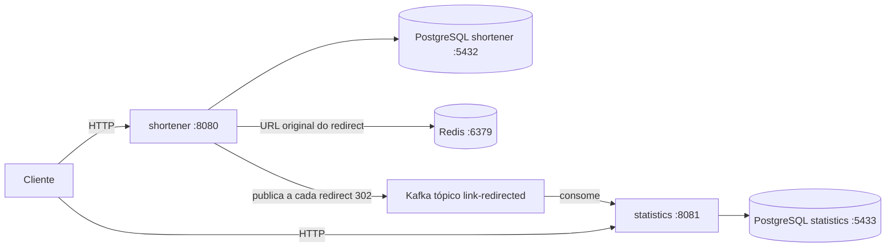

# URL Shortener

Projeto de estudos de microsserviços com Spring Boot. O objetivo é entender a fronteira entre serviços, não só encurtar uma URL.

Dois serviços não se chamam por HTTP. O encurtador guarda o vínculo entre o código e a URL original. O serviço de estatísticas guarda a contagem de acessos. O que atravessa a fronteira é um evento no Kafka.

## Arquitetura



O redirect procura a URL original no Redis. Se não estiver lá, lê o PostgreSQL e guarda por 10 minutos. Editar ou apagar o link remove essa entrada. O evento sai em todo redirect que deu certo, mesmo quando a URL veio do cache.

Um redirecionamento bem-sucedido publica `link-redirected`. A mensagem leva `eventId`, `code` e `occurredAt`. A chave é o código do link. O mesmo `eventId` não aumenta a contagem outra vez.

## Rotas

### shortener, porta 8080

| Método | Caminho | Sucesso | Corpo |
| --- | --- | --- | --- |
| `POST` | `/links` | 201 | Request `{"url":"https://..."}`. Response `code`, `shortUrl`, `originalUrl` |
| `GET` | `/links` | 200 | Lista de `code`, `shortUrl`, `originalUrl` |
| `PUT` | `/links/{code}` | 200 | Mesmo corpo do `POST`. Troca a URL original e mantém o código |
| `DELETE` | `/links/{code}` | 204 | Sem corpo |
| `GET` | `/{code}` | 302 | Sem corpo. O header `Location` é a URL original |

URL inválida responde 400 com `{"message":"..."}`. Código desconhecido no edit, no delete e no redirect responde 404 com `{"message":"short link not found: ..."}`.

O contrato do encurtador também aparece em [http://localhost:8080/swagger-ui.html](http://localhost:8080/swagger-ui.html). O JSON fica em [http://localhost:8080/v3/api-docs](http://localhost:8080/v3/api-docs).

### statistics, porta 8081

| Método | Caminho | Sucesso | Corpo |
| --- | --- | --- | --- |
| `GET` | `/links/{code}` | 200 | `code` e `accessCount` |

Um código que ainda não foi clicado responde 200 com `accessCount` 0. Este serviço não consulta o encurtador para saber se o link existe.

## Stack e serviços

| Peça | Onde entra |
| --- | --- |
| Java 21 | Os dois módulos |
| Spring Boot 4.1.1 | Parent de cada `pom.xml` |
| Spring WebMVC, Data JPA e Validation | Encurtador. Estatísticas usa WebMVC e Data JPA |
| Spring Kafka | Publicação no encurtador e consumo nas estatísticas |
| MapStruct 1.6.3 | Conversão entre entidade e resposta |
| springdoc-openapi 3.1.1 | Swagger só do encurtador |
| PostgreSQL 18 | Um banco `shortener` e outro `statistics` |
| Apache Kafka 4.1.2 | Broker em KRaft, sem ZooKeeper |
| Redis 8 | Cache da URL original no redirect do encurtador |
| JUnit 5 e Mockito | Testes dos dois módulos |
| Docker Compose | Sobe os dois serviços, os dois bancos, o Kafka e o Redis |
| GitHub Actions | Roda os testes em push e pull request |
| Liberica OpenJRE 21 | Imagem dos serviços |

Keycloak, gateway, JaCoCo e Kubernetes ainda não fazem parte do código.

## Como rodar

É preciso Docker em execução e JDK 21. Nesta máquina o JDK 21 está em `/usr/local/opt/openjdk@21`. O `java` padrão do shell pode continuar no 17.

Na raiz do repositório:

```bash
export JAVA_HOME="/usr/local/opt/openjdk@21"
export PATH="$JAVA_HOME/bin:$PATH"
./shortener/mvnw -B -f shortener/pom.xml -DskipTests package
./shortener/mvnw -B -f statistics/pom.xml -DskipTests package
docker compose up --build
```

O `Dockerfile` de cada serviço copia o jar que o Maven acabou de gerar. Sem o `package`, o build da imagem não tem o que copiar.

Crie um link:

```bash
curl -s -X POST http://localhost:8080/links \
  -H 'Content-Type: application/json' \
  -d '{"url":"https://example.com"}'
```

Abra o `shortUrl` retornado. Para ver o 302 em vez de seguir o redirect, use `curl -I`. A contagem fica em:

```bash
curl -s http://localhost:8081/links/CODIGO
```

Troque `CODIGO` pelo `code` da resposta.

Os testes dos dois módulos:

```bash
export JAVA_HOME="/usr/local/opt/openjdk@21"
export PATH="$JAVA_HOME/bin:$PATH"
./shortener/mvnw -B -f shortener/pom.xml test
./shortener/mvnw -B -f statistics/pom.xml test
```

O teste de contexto do encurtador conecta em `localhost:5432` e o cache aponta para `localhost:6379`. Com o Compose no ar, esses endereços são o banco `shortener` e o Redis. O GitHub Actions sobe os dois dentro do job.
